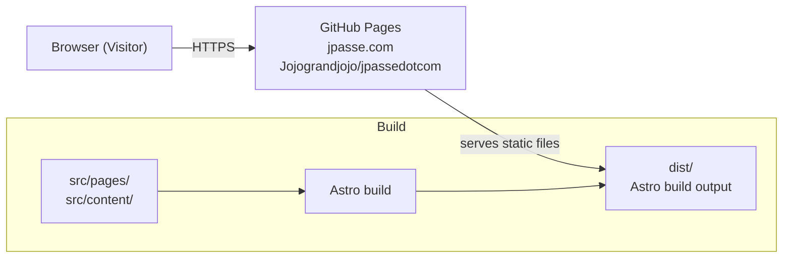

# To-Be Capability Specification: Homepage

## 1. Executive Summary & Intent

This is the first iteration of jpassedotcom — Jonathan Passe's personal software engineering portfolio. It ships a single page at jpasse.com displaying name, photo, email contact, and social links in English and French, responsive on any device. The page is built with Astro, deployed to GitHub Pages via a CI/CD pipeline with automated quality gates (tests, linting, accessibility, performance). Content sections — articles, talks, projects, events — are explicitly deferred to v2. This iteration exists to establish an online presence; everything else follows.

## 2. Desired Impact

### `IMP-01` — Live online presence at jpasse.com

**Outcome:** A potential client or employer navigates to jpasse.com and sees Jonathan Passe's name, photo, email contact, and social links — in their choice of English or French — on a page that works on their phone and their desktop.

| Id       | Validation                                        | Strategy                                                          | Baseline                       | Target                                |
| -------- | ------------------------------------------------- | ----------------------------------------------------------------- | ------------------------------ | ------------------------------------- |
| `VAL-01` | Page is accessible at jpasse.com over HTTPS       | Navigate to the domain from an external network                   | Not deployed (`GAP-05`)        | 200 OK, HTTPS enforced                |
| `VAL-02` | Page renders name, photo, email, and social links | Visual check + automated link checker                             | "Astro" boilerplate (`SCN-01`) | All five elements present and visible |
| `VAL-03` | Page is available in English and French           | Navigate to `/en/` and `/fr/`, verify content in correct language | English-only (`BR-LANG-01`)    | Both languages accessible             |

### `IMP-02` — Visitors can contact me

**Outcome:** A visitor who wants to reach Jonathan can do so from the portfolio page immediately, with no friction.

| Id       | Validation                                        | Strategy                                       | Baseline                        | Target                                   |
| -------- | ------------------------------------------------- | ---------------------------------------------- | ------------------------------- | ---------------------------------------- |
| `VAL-04` | Email link opens mail client with correct address | Click the mailto link and verify the To: field | No contact mechanism (`GAP-01`) | Correct email address populated          |
| `VAL-05` | Social links resolve to correct profiles          | Click each link, verify destination            | No social links (`GAP-01`)      | All links point to the intended profiles |

---

## 3. The Business Lens

### 3.1 Business Context & Strategic Goals

jpassedotcom is Jonathan Passe's software engineering portfolio. The As-Is baseline (`ASIS-PORTFOLIO-v1.0`) records an Astro scaffold with no content, no deployment, and no bilingual support. This iteration ships the MVP defined in DR-0001: a single page with name, photo, email, and social links, bilingual in English and French (DR-0005), responsive (DR-0002), deployed to jpasse.com via GitHub Pages (DR-0004).

The strategic goal is simple: exist online. A shipped page is the foundation; content sections (articles, talks, projects, events) follow in later iterations.

### 3.2 Target User Profiles

| Id       | Profile            | Description                                                                           | Primary needs                                                                  |
| -------- | ------------------ | ------------------------------------------------------------------------------------- | ------------------------------------------------------------------------------ |
| `USR-01` | Potential Client   | Someone evaluating whether to hire or contract Jonathan for software engineering work | See who Jonathan is at a glance; confirm professionalism; find contact details |
| `USR-02` | Potential Employer | Recruiter or hiring manager considering Jonathan for a role                           | See who Jonathan is; find contact details; form a first impression             |

### 3.3 End-to-End Business Processes

#### `PRC-01` — Visitor discovers and views portfolio

1. Visitor encounters a link to jpasse.com (search, referral, resume, social bio) — _outside the system_
2. Visitor navigates to jpasse.com → `SCN-01`
3. Visitor reads the page, optionally switches language → `SCN-02`
4. Visitor may click email or social link → `SCN-03`

### 3.4 Strict Business Rules

| Id              | Rule (EARS)                                                                                                        | Source       | Rationale                                                        |
| --------------- | ------------------------------------------------------------------------------------------------------------------ | ------------ | ---------------------------------------------------------------- |
| `BR-LANG-01`    | THE system SHALL serve every page in English and French, with the visitor able to switch between them at any time. | DR-0005, SME | Bilingual is a requirement for targeting French-speaking clients |
| `BR-RESP-01`    | THE system SHALL render legibly on viewport widths from 320px to 2560px without horizontal scroll.                 | DR-0002, SME | Employers and clients view on both mobile and desktop            |
| `BR-CONTACT-01` | THE system SHALL display an email contact link and social profile links on the page.                               | DR-0001, SME | Primary MVP content                                              |

### 3.5 Capability Scenarios

#### `SCN-01` — Visitor views portfolio page

**Actor:** `USR-01` or `USR-02` (any visitor)
**Trigger:** Visitor navigates to jpasse.com
**Outcome:** Visitor sees Jonathan's name, photo, and a brief professional identity statement in the default language (inferred from browser)

**Steps**

1. Visitor navigates to jpasse.com
2. The system serves the portfolio page in the visitor's preferred language (inferred from `Accept-Language` header)
3. Visitor sees Jonathan's name, photo, the professional identity statement, email link, and LinkedIn link
4. The page renders correctly on the visitor's device

**Acceptance criteria (EARS)**

| Id        | Criterion                                                                                                   |
| --------- | ----------------------------------------------------------------------------------------------------------- |
| `AC-01.1` | WHEN a visitor navigates to jpasse.com THE system SHALL respond with HTTP 200 and serve the portfolio page. |
| `AC-01.2` | THE system SHALL display Jonathan Passe's full name prominently on the page.                                |
| `AC-01.3` | THE system SHALL display a photo of Jonathan Passe on the page.                                             |
| `AC-01.4` | THE system SHALL display a one-line professional identity statement.                                        |
| `AC-01.5` | THE system SHALL render the page without horizontal scroll at any viewport width from 320px to 2560px.      |

**Error cases**

| Id         | Criterion                                                                                              |
| ---------- | ------------------------------------------------------------------------------------------------------ |
| `ERR-01.1` | IF the requested page does not exist THEN THE system SHALL serve a 404 page in the visitor's language. |

**Rules applied:** `BR-LANG-01`, `BR-RESP-01`, `BR-CONTACT-01`
**Impacts served:** `IMP-01`

---

#### `SCN-02` — Visitor switches language

**Actor:** `USR-01` or `USR-02`
**Trigger:** Visitor clicks language toggle
**Outcome:** Page content is displayed in the selected language

**Steps**

1. Visitor is viewing the portfolio page in one language (English or French)
2. Visitor clicks the language toggle
3. The system reloads the page in the other language
4. All content — name, identity statement, link labels — is in the selected language

**Acceptance criteria (EARS)**

| Id        | Criterion                                                                                                 |
| --------- | --------------------------------------------------------------------------------------------------------- |
| `AC-02.1` | WHEN a visitor clicks the language toggle THE system SHALL serve the same page in the alternate language. |
| `AC-02.2` | THE system SHALL display a visible language toggle on every page.                                         |
| `AC-02.3` | WHEN the page loads in English THE system SHALL render all user-facing text in English.                   |
| `AC-02.4` | WHEN the page loads in French THE system SHALL render all user-facing text in French.                     |

**Error cases**

| Id         | Criterion                                                                                                                                                    |
| ---------- | ------------------------------------------------------------------------------------------------------------------------------------------------------------ |
| `ERR-02.1` | IF a translation is missing for a piece of content THEN THE system SHALL fall back to the other language for that content only rather than showing an error. |

**Rules applied:** `BR-LANG-01`
**Impacts served:** `IMP-01`

---

#### `SCN-03` — Visitor contacts Jonathan

**Actor:** `USR-01` or `USR-02`
**Trigger:** Visitor clicks email link or social link
**Outcome:** Visitor's mail client opens or social profile loads in a new tab

**Steps**

1. Visitor is viewing the portfolio page
2. Visitor clicks the email link
3. The system opens the visitor's default mail client with Jonathan's email address in the To: field
4. OR visitor clicks a social link
5. The system opens the social profile in a new browser tab

**Acceptance criteria (EARS)**

| Id        | Criterion                                                                                                                |
| --------- | ------------------------------------------------------------------------------------------------------------------------ |
| `AC-03.1` | WHEN a visitor clicks the email link THE system SHALL open a `mailto:` URI with the correct email address.               |
| `AC-03.2` | WHEN a visitor clicks a social link THE system SHALL open the destination in a new tab with `rel="noopener noreferrer"`. |

**Error cases**

| Id         | Criterion                                                                                                                       |
| ---------- | ------------------------------------------------------------------------------------------------------------------------------- |
| `ERR-03.1` | IF a social link destination is unreachable THEN the behaviour is outside the system's control — no error handling is required. |

**Rules applied:** `BR-CONTACT-01`
**Impacts served:** `IMP-02`

---

## 4. The Technical Lens

### 4.1 Architectural Requirements & Domain Context

The capability is a single static site deployed to GitHub Pages. No server runtime, no database, no external API dependencies. The architecture constraint is simplicity: one `astro build` produces a `dist/` directory that GitHub Pages serves directly. The i18n strategy uses subdirectory routing (`/en/`, `/fr/`) with the root `/` redirecting based on `Accept-Language`.

The bounded context is fully self-contained — the portfolio site is the entire system for this iteration.

### 4.2 Consumers

| Id       | Consumer                  | Protocol      | What it needs                           | Data shape                             |
| -------- | ------------------------- | ------------- | --------------------------------------- | -------------------------------------- |
| `CON-01` | Web browser (any visitor) | HTTPS, HTTP/2 | The portfolio page in English or French | HTML page with embedded image and text |

### 4.3 Providers (Dependencies)

None. The site has no runtime dependencies and no external API calls.

### 4.4 System Topology

### 4.5 Technology Stack

| Layer           | Choice                                               | Rationale                                                              |
| --------------- | ---------------------------------------------------- | ---------------------------------------------------------------------- |
| Runtime         | Node.js >=22.12.0 (v26 in use)                       | Already available; Astro requirement                                   |
| Framework       | Astro 7.2.0                                          | Chosen in DR-0003; static output, Markdown-native, component model     |
| Language        | TypeScript (Astro strict)                            | Type safety; Astro default                                             |
| Package manager | npm                                                  | Already in use; lockfile present                                       |
| Hosting         | GitHub Pages                                         | Chosen in DR-0004; free, custom domain support, HTTPS                  |
| i18n            | Astro built-in (subdirectory routing `/en/`, `/fr/`) | Standard approach; no extra dependencies; works with static hosting    |
| Testing         | Vitest                                               | Specified in AGENT.md; fast, native ESM support, Astro-compatible      |
| Linting         | ESLint + eslint-plugin-astro                         | Specified in AGENT.md                                                  |
| Formatting      | Prettier                                             | Specified in AGENT.md                                                  |
| CI/CD           | GitHub Actions                                       | Free for public repos; native integration with GitHub Pages deployment |

### 4.6 Cross-Functional Requirements

| Id            | Requirement (EARS)                                                                                                                         | Threshold                                         | Verification method                                                                 |
| ------------- | ------------------------------------------------------------------------------------------------------------------------------------------ | ------------------------------------------------- | ----------------------------------------------------------------------------------- |
| `CFR-PERF-01` | WHEN a visitor requests the portfolio page THE system SHALL deliver a First Contentful Paint within 2 seconds on a 3G connection.          | FCP <= 2s at 3G (400 Kbps, 100ms RTT)             | Lighthouse audit in CI (local dev server acceptable for v1; no deployed monitoring) |
| `CFR-SEC-01`  | THE system SHALL serve all traffic over HTTPS with HSTS.                                                                                   | HTTPS enforced; HTTP requests return 301 redirect | Manual verification at deploy time (GitHub Pages enforces HTTPS by default)         |
| `CFR-SEC-02`  | THE system SHALL NOT execute any third-party JavaScript.                                                                                   | Zero third-party scripts in the page source       | Automated check: scan built HTML for external `<script>` tags                       |
| `CFR-PRIV-01` | THE system SHALL NOT set any cookies or load any trackers.                                                                                 | Zero cookies, zero analytics scripts              | Automated check: scan built HTML and response headers                               |
| `CFR-A11Y-01` | THE system SHALL pass WCAG 2.1 Level AA on every page.                                                                                     | Lighthouse accessibility score >= 95              | Lighthouse audit in CI                                                              |
| `CFR-A11Y-02` | THE system SHALL include a valid `lang` attribute on the `<html>` element matching the page language, and an `alt` attribute on the photo. | `lang` matches page locale; `alt` is non-empty    | Automated check in Vitest or Lighthouse                                             |

### 4.7 Quality Assurance & Compliance Strategy

**Pipeline.** A GitHub Actions workflow runs on every push to `main` and on pull requests. The pipeline has two stages: verify and deploy.

**Verify stage** (runs on every push):

| Level         | What                                                    | Tool          |
| ------------- | ------------------------------------------------------- | ------------- |
| Unit          | Component rendering, link integrity, language detection | Vitest        |
| Accessibility | WCAG 2.1 AA on every page                               | Lighthouse CI |
| Performance   | FCP on 3G                                               | Lighthouse CI |
| Linting       | ESLint (with eslint-plugin-astro)                       | ESLint        |
| Formatting    | Prettier                                                | Prettier      |
| Build         | `astro build` succeeds                                  | Astro CLI     |

**Deploy stage** (runs only if verify passes):

| Step   | What                                           | Tool                         |
| ------ | ---------------------------------------------- | ---------------------------- |
| Build  | `astro build` → `dist/`                        | Astro CLI                    |
| Deploy | Push `dist/` to GitHub Pages `gh-pages` branch | `peaceiris/actions-gh-pages` |

**Notifications.** The pipeline notifies on failure. For a single-person project, two free mechanisms: GitHub built-in email notifications (Settings → Notifications → Actions, on by default for repo owners) and GitHub Mobile app push notifications. If richer notifications are wanted later, ntfy.sh is a free, open-source pub/sub system — out of scope for v1.

No compliance regime applies to a personal portfolio site.

---

## 5. Out of Scope

| Not doing                               | Why                                                          | Deferred to       |
| --------------------------------------- | ------------------------------------------------------------ | ----------------- |
| Articles listing                        | Content does not exist yet                                   | v2                |
| Talks listing                           | Content does not exist yet                                   | v2                |
| Public projects listing                 | Content does not exist yet                                   | v2                |
| Upcoming events listing                 | Content does not exist yet                                   | v2                |
| Blog                                    | Separate concern; portfolio page ships first                 | v2                |
| Analytics                               | Premature before traffic exists                              | v2                |
| Dark mode                               | Visual polish; ship content first                            | v2                |
| Brand refinement (colours, fonts, tone) | Needs dedicated design thinking; unblocked once page is live | v2                |
| ntfy.sh notifications                   | GitHub defaults suffice for a single-person project          | v2 or when needed |

---

## 6. Known Unknowns & Open Questions

### 6.1 Business & UX Open Questions

| Id         | Question                                                                                                                                                                                                                                                                                              | Owner          | Blocks             | Needed by              |
| ---------- | ----------------------------------------------------------------------------------------------------------------------------------------------------------------------------------------------------------------------------------------------------------------------------------------------------- | -------------- | ------------------ | ---------------------- |
| `Q-BIZ-01` | ~~What is the photo to be used on the portfolio page?~~ → Resolved: `Pictures/professional_high_res/Attachments-Re_ Photo selection/927A7802-2-2.jpg` (to be copied into `public/` or `src/assets/`)                                                                                                  | Jonathan Passe | `SCN-01`           | ✅ Resolved 2025-08-10 |
| `Q-BIZ-02` | ~~Which social links (beyond email) should appear on the page?~~ → Resolved: LinkedIn `https://www.linkedin.com/in/jonathan-passe-618579127/`                                                                                                                                                         | Jonathan Passe | `SCN-01`, `SCN-03` | ✅ Resolved 2025-08-10 |
| `Q-BIZ-03` | ~~What is the one-line professional identity statement?~~ → Resolved: "I bridge the gap between technical architecture and human knowledge. Drawing on a decade in developer platforms, GenAI modernization, and spec-driven flows, I build products that democratize access to complex information." | Jonathan Passe | `SCN-01`           | ✅ Resolved 2025-08-10 |

### 6.2 Technical & Architectural Open Questions

| Id          | Question                                                                                           | Owner          | Blocks                       | Needed by              |
| ----------- | -------------------------------------------------------------------------------------------------- | -------------- | ---------------------------- | ---------------------- |
| `Q-TECH-01` | ~~What is the GitHub repository URL?~~ → Resolved: `https://github.com/Jojograndjojo/jpassedotcom` | Jonathan Passe | `CFR-SEC-01`, CI/CD pipeline | ✅ Resolved 2025-08-10 |

---

## Appendix — EARS quick reference

| Pattern            | Shape                                                           | Example                                                                                                         |
| ------------------ | --------------------------------------------------------------- | --------------------------------------------------------------------------------------------------------------- |
| Ubiquitous         | THE `<system>` SHALL `<response>`                               | THE system SHALL log every authentication attempt.                                                              |
| Event-driven       | WHEN `<trigger>` THE `<system>` SHALL `<response>`              | WHEN a user submits the login form THE system SHALL validate credentials against the auth provider.             |
| State-driven       | WHILE `<state>` THE `<system>` SHALL `<response>`               | WHILE a sync is in progress THE system SHALL display a non-dismissable progress indicator.                      |
| Unwanted behaviour | IF `<trigger>` THEN THE `<system>` SHALL `<response>`           | IF credential validation fails three times in 60 seconds THEN THE system SHALL lock the account for 15 minutes. |
| Optional feature   | WHERE `<feature is included>` THE `<system>` SHALL `<response>` | WHERE multi-factor authentication is enabled THE system SHALL require a TOTP code after password validation.    |
| Complex            | Combine, state before trigger                                   | WHILE in maintenance mode WHEN a write is received THE system SHALL reject it with 503.                         |

- One requirement, one sentence, one SHALL.
- SHALL is the only modal. No should, may, or must.
- The system is the actor, not the user.
- If you cannot pick a pattern, the requirement is probably not yet a requirement — send it to §6.
