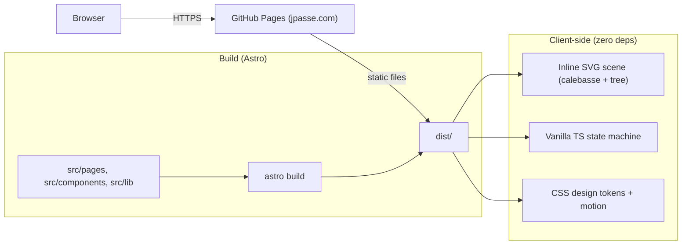

# To-Be Capability Specification: Homepage

## 1. Executive Summary & Intent

The homepage redesign turns the single static card shipped in v1.0 into an animated introduction built on two Chadian symbols — the calebasse (calabash) and the tree. Identity, identity statement, and contact links stay visible on load. A welcome line invites the visitor to click the calebasse, which opens 90° to reveal the main picture, then the detail pictures/captions. A branch then grows out of the opened gourd carrying the menu leaves (one today: Articles), and a small decorative loop plays the red-green-refactor cycle (red → green → shape-change → fewer leaves). Everything stays bilingual, responsive, static, third-party-JS-free, and progressively enhanced — the reveal is a decoration on an already-complete page.

> **Baseline note:** `builds_on_as_is` points at `ASIS-HOMEPAGE-v1.0`, which predates the v1.0 build and is stale. Reconciliation (§0, run during authoring) treated the actual shipped code as the baseline. See `Q-TECH-01` for re-promotion.

## 2. Desired Impact

### `IMP-01` — The calebasse + tree tell the introduction story

**Outcome:** a visitor sees the always-visible identity, is invited to click, and the picture, details, and menu reveal through the opening gourd and growing branch.

| Id | Validation | Strategy | Baseline | Target |
| --- | --- | --- | --- | --- |
| `VAL-01` | The calebasse opens via keyboard *and* pointer | Vitest (jsdom) interaction test + manual keyboard check | No interaction exists | Both Enter/Space and click open the reveal |
| `VAL-02` | Photo + details present in the HTML without JS | Build-output test (extend `homepage.test.ts`) | v1.0 photo is static | Reveal content in served HTML with JS disabled |
| `VAL-03` | No animation under `prefers-reduced-motion` | Test asserting the reduced-motion path | n/a | Zero animation; content fully visible |

### `IMP-02` — Core purpose survives zero interaction

**Outcome:** name, identity, email, LinkedIn are visible on load; the calebasse is an enhancement, not a gate.

| Id | Validation | Strategy | Baseline | Target |
| --- | --- | --- | --- | --- |
| `VAL-04` | Identity + contact visible with no interaction | Existing + new `homepage.test.ts` checks | Already true in v1.0 | Unchanged |

### `IMP-03` — Fast and accessible despite the animation

**Outcome:** FCP ≤ 2s, WCAG 2.1 AA, zero third-party JS, zero cookies — all hold after the animation lands.

| Id | Validation | Strategy | Baseline | Target |
| --- | --- | --- | --- | --- |
| `VAL-05` | Lighthouse accessibility ≥ 95 and FCP ≤ 2s in CI | `lhci autorun` (already wired) | Configured in v1.0 | Holds after animation |
| `VAL-06` | No third-party JS, no cookies/trackers in built HTML | `privacy.test.ts` (existing) | Passes | Still passes |

---

## 3. The Business Lens

### 3.1 Business Context & Strategic Goals

jpassedotcom is Jonathan Passe's bilingual software-engineering portfolio. v1.0 shipped a single static card (name, photo, identity, email, LinkedIn). This iteration turns that card into an animated introduction using the calebasse and the tree — a deliberate proof of front-end craft aimed at the same two audiences: the animation itself demonstrates SVG, motion, accessibility, and performance discipline. The core purpose is unchanged: introduce Jonathan and make contact frictionless.

### 3.2 Target User Profiles

| Id | Profile | Description | Primary needs |
| --- | --- | --- | --- |
| `USR-01` | Potential client | Someone evaluating whether to hire Jonathan | See who he is at a glance; a signal of craft; contact details |
| `USR-02` | Potential employer | Recruiter or hiring manager | First impression; evidence of front-end skill; contact details |

### 3.3 End-to-End Business Processes

#### `PRC-01` — Visitor discovers and is introduced

1. Visitor encounters a link to jpasse.com (outside the system) → `SCN-01`
2. Visitor optionally switches language → `SCN-02`
3. Visitor activates the calebasse and watches the reveal → `SCN-04`
4. The red-green-refactor loop plays after the reveal → `SCN-05`

#### `PRC-02` — Visitor contacts Jonathan

1. Visitor clicks email or LinkedIn → `SCN-03`

*(Menu navigation to Articles is future — the leaf renders but its destination is `Q-BIZ-01`.)*

### 3.4 Strict Business Rules

| Id | Rule (EARS) | Source | Rationale |
| --- | --- | --- | --- |
| `BR-LANG-01` | THE system SHALL serve every page in English and French. | DR-0005, SME | Bilingual is a hard requirement for French-speaking clients |
| `BR-LANG-02` | THE system SHALL provide a language switch on every page. | DR-0005, SME | Visitors must be able to change language at any time |
| `BR-RESP-01` | THE system SHALL render legibly on viewport widths from 320px to 2560px without horizontal scroll. | DR-0002, SME | Mobile and desktop are both target contexts |
| `BR-CONTACT-01` | THE system SHALL display an email contact link and a social profile link on the page. | DR-0001, SME | Primary MVP content |
| `BR-IDENTITY-01` | THE system SHALL display the name, identity statement, and contact links without requiring any interaction. | DR-0015, SME | The portfolio's purpose must survive zero interaction |
| `BR-REACH-01` | THE system SHALL keep the photograph and detail content present in the served markup regardless of JavaScript availability. | DR-0029, SME | Crawlers and no-JS visitors must still see the content |
| `BR-MENU-01` | THE system SHALL keep the menu leaves stable and selectable while the red-green-refactor loop runs. | DR-0027, SME | Navigation must never morph or disappear |

### 3.5 Capability Scenarios

#### `SCN-01` — Visitor views the portfolio page

**Actor:** `USR-01` or `USR-02`
**Trigger:** navigates to jpasse.com
**Outcome:** sees identity, contact, and welcome; photo/details present in markup, visually behind the calebasse.

**Steps**

1. Visitor navigates to jpasse.com
2. The system serves the page in the visitor's language (root redirect → `/en/` or `/fr/`)
3. Visitor sees name, identity statement, email, LinkedIn, and a welcome line inviting them to click the calebasse
4. The photo and detail content are present in the markup (visible without JS; revealed by the calebasse when JS is on)
5. The page renders without horizontal scroll at any width

**Acceptance criteria (EARS)**

| Id | Criterion |
| --- | --- |
| `AC-01.1` | WHEN a visitor navigates to the site THE system SHALL respond with HTTP 200 and serve the homepage in the visitor's language. |
| `AC-01.2` | THE system SHALL display the name, identity statement, email link, and LinkedIn link without requiring interaction. |
| `AC-01.3` | THE system SHALL display a welcome line inviting the visitor to click the calebasse. |
| `AC-01.4` | THE system SHALL include the photograph and detail content in the served markup regardless of JavaScript. |
| `AC-01.5` | THE system SHALL render without horizontal scroll at any viewport width from 320px to 2560px. |

**Error cases**

| Id | Criterion |
| --- | --- |
| `ERR-01.1` | IF the requested page does not exist THEN THE system SHALL serve a 404 page in the visitor's language. |

**Rules applied:** `BR-LANG-01`, `BR-LANG-02`, `BR-RESP-01`, `BR-CONTACT-01`, `BR-IDENTITY-01`, `BR-REACH-01`
**Impacts served:** `IMP-01`, `IMP-02`

---

#### `SCN-02` — Visitor switches language

**Actor:** `USR-01` or `USR-02`
**Trigger:** visitor clicks the language toggle
**Outcome:** page content is displayed in the selected language

**Steps**

1. Visitor is viewing the page in one language (English or French)
2. Visitor clicks the language toggle
3. The system serves the same page in the alternate language
4. All content — name, identity statement, welcome line, link labels — is in the selected language

**Acceptance criteria (EARS)**

| Id | Criterion |
| --- | --- |
| `AC-02.1` | WHEN a visitor clicks the language toggle THE system SHALL serve the same page in the alternate language. |
| `AC-02.2` | THE system SHALL display a visible language toggle on every page. |
| `AC-02.3` | WHEN the page loads in English THE system SHALL render all user-facing text in English. |
| `AC-02.4` | WHEN the page loads in French THE system SHALL render all user-facing text in French. |

**Error cases**

| Id | Criterion |
| --- | --- |
| `ERR-02.1` | IF a translation is missing for a piece of content THEN THE system SHALL fall back to the other language for that content only rather than showing an error. |

**Rules applied:** `BR-LANG-01`, `BR-LANG-02`
**Impacts served:** `IMP-02`

---

#### `SCN-03` — Visitor contacts Jonathan

**Actor:** `USR-01` or `USR-02`
**Trigger:** visitor clicks the email link or social link
**Outcome:** the mail client opens, or the social profile loads in a new tab

**Steps**

1. Visitor is viewing the page
2. Visitor clicks the email link
3. The system opens the visitor's default mail client with Jonathan's address in the To: field
4. OR the visitor clicks a social link
5. The system opens the social profile in a new browser tab

**Acceptance criteria (EARS)**

| Id | Criterion |
| --- | --- |
| `AC-03.1` | WHEN a visitor clicks the email link THE system SHALL open a `mailto:` URI with the correct email address. |
| `AC-03.2` | WHEN a visitor clicks a social link THE system SHALL open the destination in a new tab with `rel="noopener noreferrer"`. |

**Error cases**

| Id | Criterion |
| --- | --- |
| `ERR-03.1` | IF a social link destination is unreachable THEN the behaviour is outside the system's control — no error handling is required. |

**Rules applied:** `BR-CONTACT-01`
**Impacts served:** `IMP-02`

---

#### `SCN-04` — Visitor opens the calebasse

**Actor:** `USR-01` or `USR-02`
**Trigger:** activates the calebasse (pointer or keyboard)
**Outcome:** gourd opens, picture reveals, details cascade, branch grows, menu leaves appear.

**Steps**

1. Visitor sees the welcome invitation on the calebasse
2. Visitor activates the calebasse (click, or Enter/Space while focused)
3. The calebasse opens on its hinge to 90° (800ms, ease-in-out)
4. The main picture settles into the two-column layout
5. The detail pictures/captions cascade below the photo
6. The branch draws out of the opened gourd
7. The menu leaves pop in along the branch, staggered

**Acceptance criteria (EARS)**

| Id | Criterion |
| --- | --- |
| `AC-04.1` | WHEN the visitor clicks the calebasse THE system SHALL open it and run the reveal sequence. |
| `AC-04.2` | WHEN the visitor presses Enter or Space on the focused calebasse THE system SHALL open it and run the reveal sequence. |
| `AC-04.3` | WHEN the calebasse opens THE system SHALL set its `aria-expanded` state to true. |
| `AC-04.4` | WHEN the reveal runs THE system SHALL display the main picture, then the details, then the branch, then the menu leaves, in that order. |
| `AC-04.5` | WHILE the calebasse is open THE system SHALL keep the revealed content visible. |

**Error cases**

| Id | Criterion |
| --- | --- |
| `ERR-04.1` | IF the calebasse is already open THEN THE system SHALL not restart the reveal sequence. |

**Rules applied:** `BR-IDENTITY-01`, `BR-MENU-01`
**Impacts served:** `IMP-01`, `IMP-02`

---

#### `SCN-05` — Red-green-refactor loop

**Actor:** the system (autonomous)
**Trigger:** the reveal sequence (`SCN-04`) completes
**Outcome:** a decorative loop cycles red → green → shape-change → fewer leaves, independent of the menu.

**Steps**

1. The reveal sequence completes
2. A decorative branch plays the loop: leaves appear red (`#BF3100`), turn green (`#2E7D32`), morph shape, then the next iteration shows fewer leaves
3. The loop repeats (~2.5–3s per cycle)
4. The menu leaves remain stable and selectable throughout

**Acceptance criteria (EARS)**

| Id | Criterion |
| --- | --- |
| `AC-05.1` | WHEN the reveal sequence completes THE system SHALL start the red-green-refactor loop. |
| `AC-05.2` | WHILE the loop runs THE system SHALL keep the menu leaves stable and selectable. |
| `AC-05.3` | THE system SHALL cycle each iteration through red, then green, then a shape change, then fewer leaves. |

**Error cases**

| Id | Criterion |
| --- | --- |
| `ERR-05.1` | IF the visitor's system requests reduced motion THEN THE system SHALL not run the loop. |

**Rules applied:** `BR-MENU-01`
**Impacts served:** `IMP-01`

---

## 4. The Technical Lens

### 4.1 Architectural Requirements & Domain Context

The capability remains a single static site: no server runtime, no database, no external API. The animation is **client-side only** — inline SVG plus a small vanilla-TypeScript state machine — with **zero new dependencies**, honouring `CFR-SEC-02`. It is progressively enhanced: the reveal content is in the served markup, and the animation decorates an already-complete page (DR-0029). The bounded context is the portfolio site; i18n subdirectory routing (`/en/`, `/fr/`) is already in place and unchanged.

### 4.2 Consumers

| Id | Consumer | Protocol | What it needs | Data shape |
| --- | --- | --- | --- | --- |
| `CON-01` | Web browser (any visitor) | HTTPS, HTTP/2 | Homepage in en/fr; an operable, accessible animated scene; reduced-motion support | HTML + inline SVG + one vanilla TS script |

### 4.3 Providers (Dependencies)

| Id | Provider | Protocol | What we need from it | Failure mode if unavailable |
| --- | --- | --- | --- | --- |
| `PRV-01` | Google Fonts (Titillium Web) | HTTPS | Font files (weights 400/600) | Graceful fallback to the `system-ui` stack already in the font token |

*(No other runtime dependencies.)*

### 4.4 System Topology

### 4.5 Technology Stack

| Layer | Choice | Rationale |
| --- | --- | --- |
| Runtime | Node ≥22 (v26) | Existing |
| Framework | Astro 7.2 | DR-0003; static output |
| Language | TypeScript (Astro strict) | Existing |
| Animation | Inline SVG + CSS animations + vanilla TS state machine | Zero deps, animatable, a11y-friendly (DR-0022/0025/0026) |
| i18n | Astro subdirectory routing | Existing, static-hosting compatible (DR-0032) |
| Testing | Vitest | Existing (AGENT.md) |
| QA | ESLint, Prettier, Lighthouse CI | Existing |

### 4.6 Cross-Functional Requirements

| Id | Requirement (EARS) | Threshold | Verification method |
| --- | --- | --- | --- |
| `CFR-PERF-01` | WHEN a visitor requests the homepage THE system SHALL deliver First Contentful Paint within 2 seconds on a 3G connection. | FCP ≤ 2000ms at 3G (400 Kbps / 150ms RTT) | Lighthouse CI FCP assertion (`warn` this iteration — DR-0033) |
| `CFR-PERF-02` | THE system SHALL keep the animation payload (inline SVG + script) within 15 KB uncompressed. | ≤ 15 KB added | Build-output size check in CI |
| `CFR-SEC-01` | THE system SHALL serve all traffic over HTTPS. | HTTPS enforced | GitHub Pages enforces; manual check at deploy |
| `CFR-SEC-02` | THE system SHALL NOT execute any third-party JavaScript. | Zero external `<script src>` | `privacy.test.ts` (existing) |
| `CFR-PRIV-01` | THE system SHALL NOT set cookies or load trackers. | Zero cookies/trackers | `privacy.test.ts` (existing) |
| `CFR-A11Y-01` | THE system SHALL pass WCAG 2.1 Level AA on every page. | Lighthouse accessibility ≥ 95 | Lighthouse CI assertion (`error`) |
| `CFR-A11Y-02` | THE system SHALL include a valid `lang` attribute and non-empty `alt` text on every image. | `lang` matches locale; `alt` non-empty | Vitest + Lighthouse (`html-has-lang`, `image-alt` errors) |
| `CFR-A11Y-03` | WHERE the visitor's system requests reduced motion THE system SHALL present all content without animation. | Zero animation under `prefers-reduced-motion` | Test asserting the reduced-motion path + manual check |
| `CFR-A11Y-04` | THE system SHALL make the calebasse operable by keyboard with a visible focus indicator. | Enter/Space opens it; focus ring visible | jsdom interaction test + manual keyboard check |

*(AVAIL, OBS, COST carry no obligations this iteration — static personal site, no runtime to observe.)*

### 4.7 Quality Assurance & Compliance Strategy

**Pipeline (unchanged from v1.0):** `test.yml` runs `npm ci`, `vitest`, `astro build`, and `lhci autorun` on every push/PR; `deploy.yml` builds and deploys `dist/` to GitHub Pages only after tests pass.

**New this iteration, TDD-style (per AGENT.md):**

| Level | What | Tool |
| --- | --- | --- |
| Unit | Animation state machine (reveal sequence, red-green-refactor cycle) as a pure `src/lib/` module | Vitest |
| Unit | Calebasse keyboard operability + `aria-expanded` toggling | Vitest + jsdom |
| DOM | Photo + details present in served markup without JS | Vitest (extend `homepage.test.ts`) |
| Accessibility | WCAG AA, reduced-motion path | Lighthouse CI + tests |
| Performance | FCP + animation payload budget | Lighthouse CI + size check |
| Lint/format | ESLint + Prettier | `npm run lint` |

No compliance regime applies to a personal portfolio site.

---

## 5. Out of Scope

| Not doing | Why | Deferred to |
| --- | --- | --- |
| The Articles page itself | Content and its own capability spec do not exist yet | Articles capability (v2) |
| Additional menu leaves (Talks, Projects, Events, Podcast) | Capabilities not started | Their own capabilities |
| The detail pictures and captions (content) | Content to be supplied by the author; only the treatment is specified here | Author, before release |
| Blog | Separate concern | v2 |
| Analytics | Premature before traffic exists | v2 |
| Dark mode | Deferred since v1.0 | DR-0014 |
| Dedicated OG card | Dropped — keep `/main.jpg` | DR-0031 |
| Server-side `Accept-Language` redirect | Infeasible on static hosting | DR-0032 |
| Re-promoting the As-Is baseline to reflect shipped v1.0 | Documentation task, not behaviour | `Q-TECH-01` |

---

## 6. Known Unknowns & Open Questions

### 6.1 Business & UX Open Questions

| Id | Question | Owner | Blocks | Needed by |
| --- | --- | --- | --- | --- |
| `Q-BIZ-01` | What is the destination of the Articles leaf? (No `/articles` page exists.) | Jonathan Passe | `SCN-04` (menu leaf as a working link) | Before release |
| `Q-BIZ-02` | What are the detail pictures and captions revealed by the calebasse? | Jonathan Passe | `SCN-04` step 5 | Before release |
| `Q-BIZ-03` | Should the Articles leaf render disabled or hidden until its destination exists? | Jonathan Passe | `SCN-04` menu rendering | Implementation |
| `Q-BIZ-04` | What leaf count does the red-green-refactor loop start from, and at what count does it reset? | Jonathan Passe | `SCN-05` polish | Implementation (non-blocking) |

### 6.2 Technical & Architectural Open Questions

| Id | Question | Owner | Blocks | Needed by |
| --- | --- | --- | --- | --- |
| `Q-TECH-01` | Should `ASIS-HOMEPAGE-v1.0` be re-promoted to reflect the shipped v1.0 before v1.2 is authored? | Jonathan Passe | Nothing (documentation) | Next iteration |

---

## Appendix — EARS quick reference

| Pattern | Shape | Example |
| --- | --- | --- |
| Ubiquitous | THE `<system>` SHALL `<response>` | THE system SHALL log every authentication attempt. |
| Event-driven | WHEN `<trigger>` THE `<system>` SHALL `<response>` | WHEN a user submits the login form THE system SHALL validate credentials. |
| State-driven | WHILE `<state>` THE `<system>` SHALL `<response>` | WHILE a sync is in progress THE system SHALL display a progress indicator. |
| Unwanted behaviour | IF `<trigger>` THEN THE `<system>` SHALL `<response>` | IF validation fails three times THEN THE system SHALL lock the account. |
| Optional feature | WHERE `<feature is included>` THE `<system>` SHALL `<response>` | WHERE MFA is enabled THE system SHALL require a TOTP code. |

Rules of thumb:

- One requirement, one sentence, one SHALL.
- SHALL is the only modal. No should, may, or must.
- Name the actor as the system under specification, not the user.
- If a requirement resists every pattern, it is probably not yet a requirement — send it to §6.
